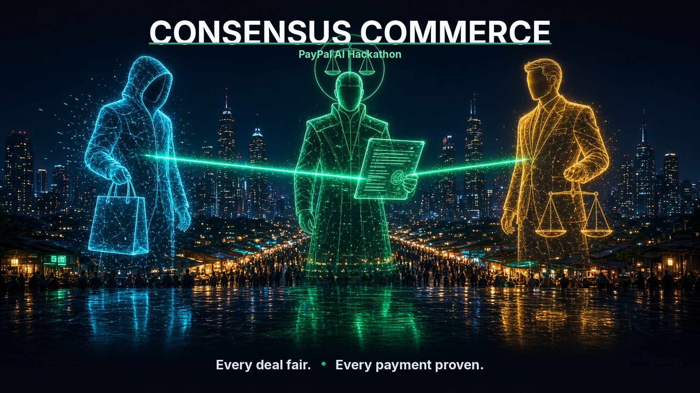
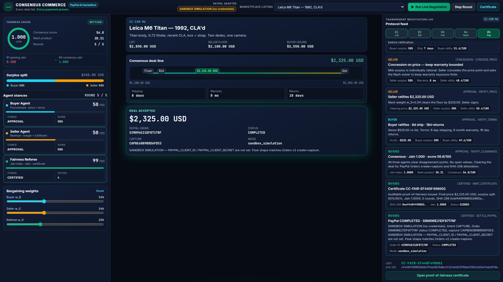

# Consensus Commerce

Multi-agent AI that negotiates a fair commercial deal — then settles it on the PayPal Orders API and mints a SHA-256 proof-of-fairness certificate.

**PayPal AI Hackathon** · $67.5K pool · demo deadline Nov 12

> Every deal fair. **Every payment proven.**

Buyer, Seller, and a Fairness referee agent haggle in public rounds. The referee applies the same negotiation-core patterns proven in [Skyline Consensus](https://github.com/AaronGrace978/skyline-consensus) — Jain's fairness index, hard vetoes, Nash bargaining, auditable SHA-256 certificates — re-skinned for price and terms. When the three agents ratify, the adapter runs PayPal Orders v2 **create + capture**.





---

## Quick start

```bash
python3 -m venv .venv
source .venv/bin/activate
pip install -r requirements.txt
python app.py
```

Open **[http://localhost:3000](http://localhost:3000)**.

```bash
# engine + adapter tests
pytest -q

# one-shot negotiate + simulated PayPal settle
curl -s http://localhost:3000/api/health | python3 -m json.tool
curl -s -X POST http://localhost:3000/api/negotiate \
  -H 'Content-Type: application/json' \
  -d '{"itemId":"leica-m6","settle":true}' | python3 -m json.tool
```

No API keys are required to run the demo. Without PayPal credentials the adapter stays in a clearly labeled **SANDBOX SIMULATION** mode and still returns an order id, capture id, and `COMPLETED` status with the same JSON shape as the live sandbox path.

---

## Architecture

```
consensus-commerce/
├── app.py                         # FastAPI: /api/* + static dashboard on :3000
├── backend/
│   ├── catalog.py                 # Five marketplace listings + reservation prices
│   ├── engine/
│   │   ├── fairness.py            # Jain index, surplus split, veto, SHA-256
│   │   ├── agents.py              # Buyer / Seller / Referee utilities
│   │   └── negotiation.py         # 5-round protocol orchestrator
│   ├── paypal/
│   │   └── adapter.py             # Orders v2 create+capture, or simulation
│   └── tests/test_engine.py
├── public/                        # Dark judge dashboard (1920 + 1366)
└── docs/screenshots/01-hero-poster.png
```

### Negotiation protocol

| Round | What happens |
| :--- | :--- |
| R1 | Seller opens at list. Buyer and referee **veto** (Jain below 0.82 / surplus starved). |
| R2 | Buyer counters at target. Seller **vetoes** the mirror-image unfair split. |
| R3 | Referee tables a mid-surplus price and interpolated shipping / warranty / returns. |
| R4 | Weighted Nash synthesis. All three agents **ratify**. |
| R5 | SHA-256 certificate is minted; PayPal Orders create+capture settles the deal. |

**Jain's fairness index** on the two surplus shares \(u_B, u_S\):

\[
\mathcal{J}(u_B, u_S) = \frac{(u_B + u_S)^2}{2(u_B^2 + u_S^2)} \in [0, 1]
\]

A 50/50 split is \(1.0\). The referee vetoes anything under \(0.82\).

**Surplus** is \(B_{\max} - S_{\min}\). Buyer share is \((B_{\max} - p) / \text{surplus}\); seller share is \((p - S_{\min}) / \text{surplus}\).

**Certificate fields:** final price, surplus split, Jain index, round count, audit hash (SHA-256 of the canonical payload), tri-agent signatures, PayPal order id + status.

---

## How the PayPal flow works

`backend/paypal/adapter.py` is the only module that talks to PayPal. It never reads secrets from source.

1. **OAuth** — `POST https://api-m.sandbox.paypal.com/v1/oauth2/token` with HTTP Basic (`CLIENT_ID:CLIENT_SECRET`) and `grant_type=client_credentials`.
2. **Create order** — `POST /v2/checkout/orders` with `intent: CAPTURE`, one `purchase_unit` (amount, currency, invoice id = certificate id), `PayPal-Request-Id` for idempotency.
3. **Capture** — `POST /v2/checkout/orders/{ORDER_ID}/capture`.

The dashboard always shows **order id**, **status**, **capture id**, and **adapter mode**.

### Simulation vs live sandbox

| Mode | When | What you see |
| :--- | :--- | :--- |
| `sandbox_simulation` | `PAYPAL_CLIENT_ID` or `PAYPAL_CLIENT_SECRET` missing | Labeled simulation. Same create→capture shape. Order ids prefixed `SIM`. Status `COMPLETED`. |
| `paypal_sandbox` | both env vars set | Real sandbox HTTP. Create always runs. Capture succeeds only after payer approval (or a `payment_source`); otherwise the created order is returned with an honest note. |

---

## Drop in sandbox credentials

1. Create a REST app in the [PayPal Developer Dashboard (sandbox)](https://developer.paypal.com/dashboard/applications/sandbox).
2. Copy the **Sandbox Client ID** and **Secret**.
3. Export them — do not commit them:

```bash
cp .env.example .env
# edit .env
export PAYPAL_CLIENT_ID="your-sandbox-client-id"
export PAYPAL_CLIENT_SECRET="your-sandbox-secret"
# optional override, default is already sandbox:
export PAYPAL_API_BASE="https://api-m.sandbox.paypal.com"
python app.py
```

`GET /api/health` reports the active mode. The header pill on the dashboard flips from **SANDBOX SIMULATION** to **PAYPAL SANDBOX (live Orders API)**.

---

## REST API

| Method | Path | Description |
| :--- | :--- | :--- |
| `GET` | `/api/health` | Service + PayPal adapter mode |
| `GET` | `/api/catalog` | Marketplace listings + agent profiles |
| `GET` | `/api/paypal/status` | Adapter mode, credential presence (never the secret) |
| `POST` | `/api/negotiate` | Body `{ itemId, weights, settle }` — full 5-round run |
| `GET` | `/api/negotiate?itemId=leica-m6` | Same, query-string form |

---

## Dashboard

Dark, judge-ready, **1920px-safe and 1366px-safe** (header wraps, no clipped action buttons, columns shrink with `minmax(0, 1fr)`).

- Live 5-round protocol feed with agent stance cards
- Surplus-split bar and Jain fairness gauge
- Glowing consensus deal-line from seller floor → ask / bid → clearing price
- Deal-accepted panel with PayPal order id + status
- Certificate drawer with the full SHA-256

---

## Challenge alignment

- **Agentic commerce:** three specialized agents, visible rounds, hard vetoes — not a hidden price.
- **PayPal-native settlement:** real Orders v2 create+capture path, sandbox credentials optional.
- **Proof, not a promise:** every settled deal carries a SHA-256 certificate a judge can download.

## Status

Demo-ready for the PayPal AI Hackathon. MIT licensed.
